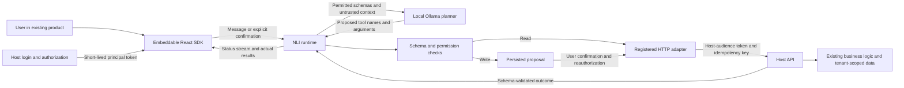

# Architecture and deployment boundaries

## System structure

The React SDK knows nothing about CRM schemas. The runtime knows principal scopes, registered contracts, conversation history and proposal state. The demo planner and CRM tools live under the demo app. A different application supplies its own registrations and endpoints while reusing the runtime and component.

## State and execution model

SQLite WAL stores conversations scoped by `(app, tenant, actor)`, immutable proposals, lifecycle statuses and audit metadata. An atomic conversation lock prevents overlapping turns. A proposal compare-and-set changes `pending` to `executing`; expiry and replay checks happen server-side. Completed proposals become `succeeded`. Unconfirmed cancelled/superseded proposals become `cancelled`. Unconfirmed expiry is enforced on claim, even if the browser clock is wrong.

An error or crash after a write starts yields `unknown`. Startup marks orphaned executions unknown. The runtime never interprets “the request was sent” as proof of a write. It never retries writes automatically. Host-side idempotency closes the duplicate-execution boundary; one runtime process alone cannot guarantee distributed exactly-once effects. Multi-step transactions belong in the host API.

Audit records identify app, tenant, user, conversation, tool, proposal and outcome. They intentionally omit full arguments, auth tokens and result payloads. Conversation history **does** contain user text, parameters and returned business data. This MVP has no automatic data retention or encryption layer; protect the database and define deletion/backup policy for a pilot. Prior message results and application context are supplied to the configured local model for contextual selection. External model endpoints are configurable but would change the data processing boundary.

## Authentication and authority

The host issues short-lived HS256 principal tokens. The runtime verifies issuer, audience, algorithm, expiry and required claims. It filters tools by signed application and permission claims and scopes conversations to the signed tenant and actor. The adapter issues a separate audience-bound token for the host API. The demo uses separate randomly generated session and adapter secrets at each launch unless configured in `.env`.

The production host must consult current authorization and row ownership at execution, including when a token still contains an old permission. Refreshing the browser token enables runtime reauthorization, but JWT expiry alone is not immediate revocation. No model output, browser context, selected ID or generated argument is authorization. Tool output is treated as untrusted data, not instructions. The UI exposes exact action parameters for human review.

Shared HMAC secrets establish one trusted deployment boundary. Do not distribute one signing secret to mutually untrusted SaaS customers. A hosted multi-customer control plane would require per-application keys/issuer validation, key rotation and independent onboarding, which are not included here.

## Local model strategy

`OllamaPlanner` uses structured output with an enum of allowed tool names plus their full input/output contracts. It receives a bounded recent history and a context object. The runtime then validates tool parameters with the registry regardless of model output. Model plan errors fail closed. Informational answers and execution success messages are runtime-owned; query results are returned as verified structured records. The MVP does not use a second unconstrained generation step to invent summaries after execution.

`DemoPlanner` is an explicitly selected deterministic phrase parser. It is intended for offline demonstrations and repeatable integration tests. It is not an LLM, does not have general language understanding, and never fabricates database results. Both planners share the execution path. Ollama failure does not silently fall back.

## Intentional MVP limits

- **Single runtime process per SQLite file.** Locks and startup recovery are designed for one owning process. Move to a transactional shared database, durable job queue and lease fencing before horizontal scaling.
- **No hosted control plane.** Registry configuration is code-owned. There is no public tool registration endpoint or automatic OpenAPI exposure.
- **No distributed transaction across tools.** Independent calls execute sequentially, bounded to four. Put atomic domain workflows behind one registered capability.
- **No automatic write retry/reconciliation.** Verify unknown outcomes in the host before creating a new proposal. A production integration should support lookup by idempotency key and an operator reconciliation workflow.
- **No model-token streaming.** NDJSON streams real execution status and final results, with heartbeat lines. A future protocol extension could add token events for grounded summaries.
- **No autonomous loops.** Read-then-write dependencies require another user turn. No arbitrary web browsing, endpoint execution, shell or SQL tools are registered.
- **Partial localization.** Core SDK labels support English and Spanish; status/error/proposal narratives remain English. `labels`, `locale` and custom result rendering are extensibility points.
- **Not a production login system.** The local CRM identity route is a deliberate sandbox shortcut. The supplied launcher rejects production mode.
- **Process-local limits.** Add upstream rate limiting, quotas, resource management, observability and retention appropriate to your environment before a public pilot.
- **Node SQLite maturity.** Node 24 emits an experimental SQLite API warning. Pin the Node major and validate upgrades; replace the store implementation if your deployment policy requires another driver.

## Customer discovery

The demo is suitable for discussing integration effort, supported workflows and trust boundaries. Validate the business hypothesis with design partners before generalizing scope. Useful pilot measures include time to complete a supported task against the existing UI, successful grounded queries, confirmation abandonment, permission-denial correctness, unknown write outcomes and integration time. No improvement in these measures is claimed by this implementation.
