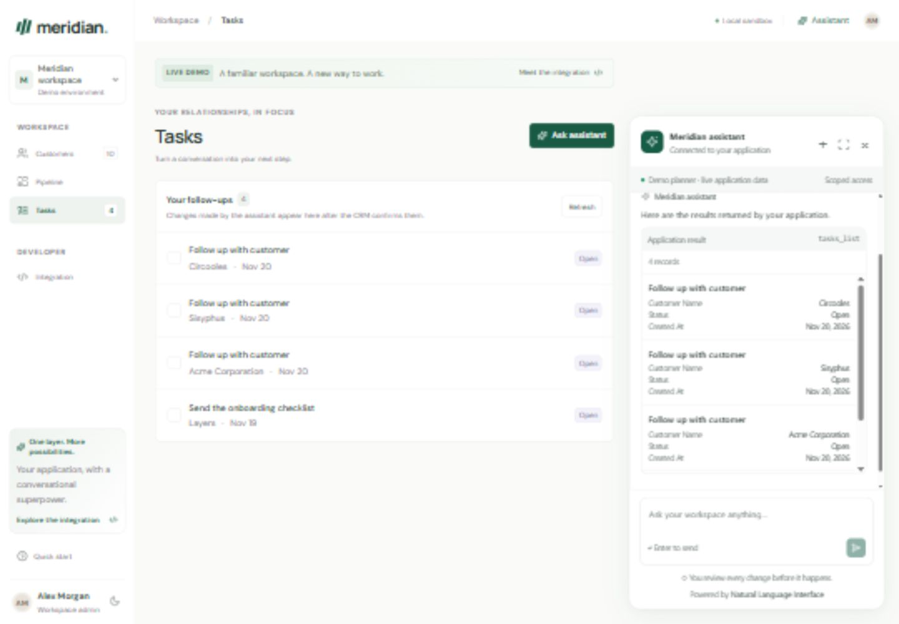
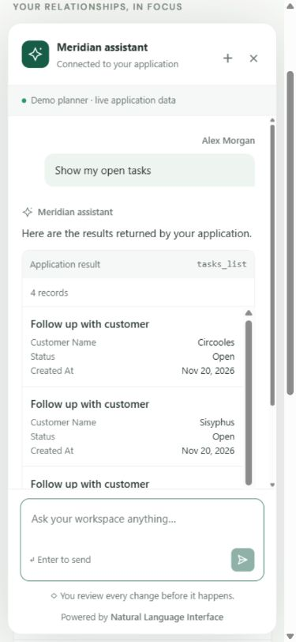

# MVP verification

Verified locally on **November 20, 2026**, using Windows, Node.js **24.14.0**, and npm **11.10.1**.

## Automated results

| Check                     | Result                                                                                                                                              |
| ------------------------- | --------------------------------------------------------------------------------------------------------------------------------------------------- |
| `npm run typecheck`       | Passed strict TypeScript checks                                                                                                                     |
| `npm test`                | **27 tests passed** across 3 files                                                                                                                  |
| `npm run build`           | Protocol, backend SDK, React SDK, runtime and demo builds passed; libraries include declarations                                                    |
| `npm run verify:packages` | Packed libraries installed into an isolated consumer; runtime/backend imports, signed-token roundtrip, React server rendering and CSS export passed |
| `npm audit`               | **0 known vulnerabilities** in the installed lockfile at verification time                                                                          |

The tests exercise:

- A real loopback HTTP flow from runtime to registered CRM endpoints to SQLite: query five inactive customers, resolve the first three from actual conversation results, propose tasks, confirm and verify exactly three new persisted records.
- Missing/tampered/expired/wrong-audience tokens, app mismatch, user/tenant/app conversation isolation, permission-filtered discovery and permission changes at confirmation.
- Cancelled, expired, superseded, foreign-conversation and replayed proposals; concurrent turn serialization.
- Host-side authorization, tenant-scoped records, atomic failure of a mixed-validity task batch, idempotent outcomes and conflicting idempotency payloads.
- Open-task filtering after a host-side task completion.
- Unknown tools, invalid arguments, mixed read/write plans, invalid output contracts, forbidden origins, HTTP redirects, real network timeout, oversized tool responses, malformed request bodies and rate limiting.
- Lost write responses: outcome remains unknown, no fabricated success and no automatic retry.
- Persistence across store restart, including interrupted executions becoming unknown.
- A separately registered operations capability using the same industry-neutral runtime. This test uses a transport fixture; the CRM integration tests use an actual HTTP server.
- Ollama request/structured-output contracts, invalid/unsupported model responses and offline failure, using controlled transport fixtures.
- NDJSON status/final events, split UTF-8 chunks, blank heartbeat lines and truncated streams.

The package check found and fixed a real bundling failure: `node:sqlite` had been rewritten to `sqlite`. The runtime now preserves Node built-in protocol prefixes. This is why package consumers are checked separately from source tests.

## Browser checks

The local Vite app was exercised in the in-app browser with desktop and narrow-screen viewport overrides. Temporary viewport overrides were restored afterward.

| Workflow                                    | Observed outcome                                                                                |
| ------------------------------------------- | ----------------------------------------------------------------------------------------------- |
| Ask for customers not contacted in 30 days  | Five CRM records returned with source attribution                                               |
| Ask for follow-up tasks for the first three | Exact three customer names and action parameters shown before execution                         |
| Let a proposal expire                       | Confirmation control disabled; a fresh proposal was required                                    |
| Confirm a fresh proposal                    | CRM returned three created tasks; host Tasks page showed those three plus its initial seed task |
| Reload after a query                        | Conversation restored within the session                                                        |
| Search for Acme                             | Directory filtered to one record                                                                |
| Open customer details, press Escape         | Native modal opened and dismissed with keyboard support                                         |
| Integration view                            | Five authorized capabilities displayed from the live runtime                                    |
| Inline assistant                            | Queried ten real CRM records with the same SDK                                                  |
| Light/dark themes                           | Both host and assistant changed theme                                                           |
| Narrow-screen assistant                     | Width overflow found and corrected; composer and close control remained usable                  |
| Browser console after reload                | No error entries returned                                                                       |

The local demo database retains the three tasks created during browser verification. These are seeded sandbox customer records, not a connection to an external CRM.





## Verification boundaries

- **No live Ollama inference was run.** No Ollama executable was found on PATH and `127.0.0.1:11434` was not listening. The implementation and model-contract/failure tests pass, but model quality, resource use and latency require validation with an installed model. The running demo used the explicitly labeled deterministic planner.
- GitHub Actions is configured for Windows and Linux, but no remote CI run, deployment or GitHub push was performed in this session.
- No load/penetration test, external host integration, browser matrix, screen-reader audit or full localization audit is claimed.
- This is a single-process local MVP. Production authentication, key lifecycle, data retention, distributed execution and reconciliation remain the host/deployment team's responsibilities, described in [architecture.md](architecture.md).
- The pasted request ended at “Validated tool arguments”; implementation covers the supplied requirements without assuming missing sections.

## Reproduce

```sh
npm ci
npm run check
npm run verify:packages
npm audit
npm run dev
```

Open `http://127.0.0.1:5173`. Use the query → first-three task proposal → confirmation workflow in the README. Signing secrets and SQLite data stay outside Git. The original Apache 2.0 license and `master` default branch remain intact.
